# Hack The Box: Meow

First, start the machine and make sure you are connected to the correct network within Hack The Box.

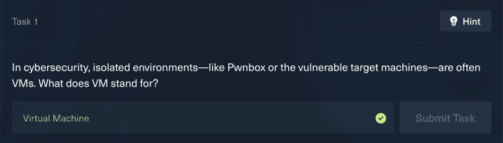

Open the bash terminal in Hack The Box. It is the green terminal in the middle.

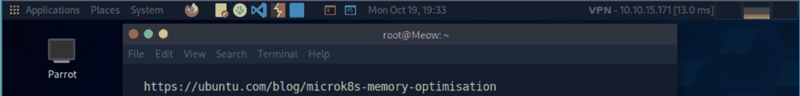

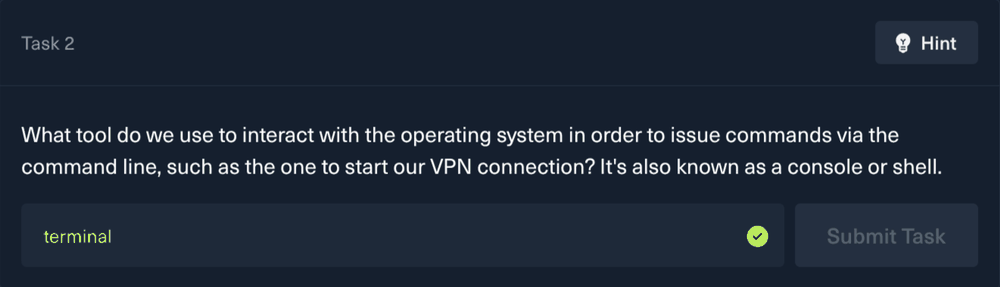

If you are not using Pwnbox, download the OpenVPN configuration and run it in a terminal. Leave that terminal open to keep the VPN connection active.

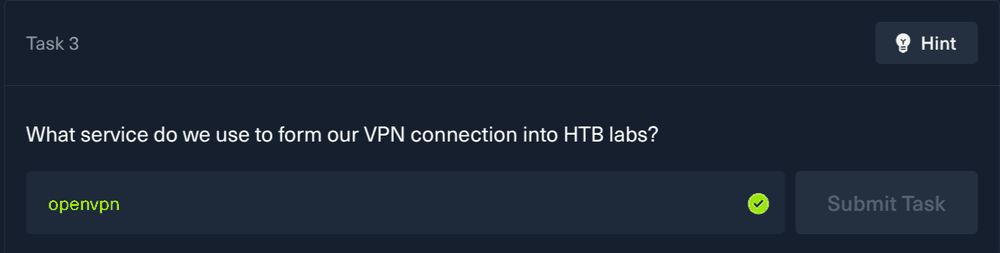

Open a terminal and ping the Meow machine's IP address. In this example, the address is `10.129.96.15`. Press Ctrl+C after a few replies. This verifies that the VPN is working and your machine is on the correct network.

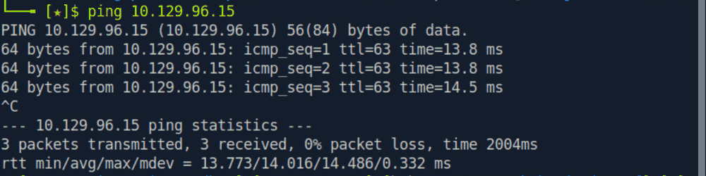

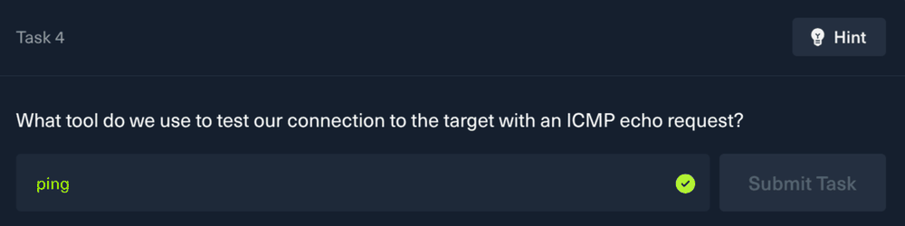

Use Nmap to identify open ports and the services running on the target.

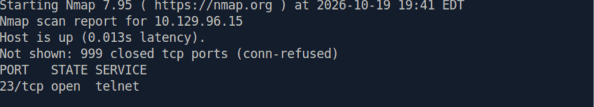

The scan shows Telnet open on TCP port 23. Telnet is a command-line protocol for remotely connecting to computers, but it does not encrypt traffic.

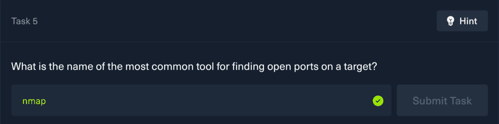

Connect to the service by specifying the target address and port:

```sh
telnet 10.129.96.15 23
```

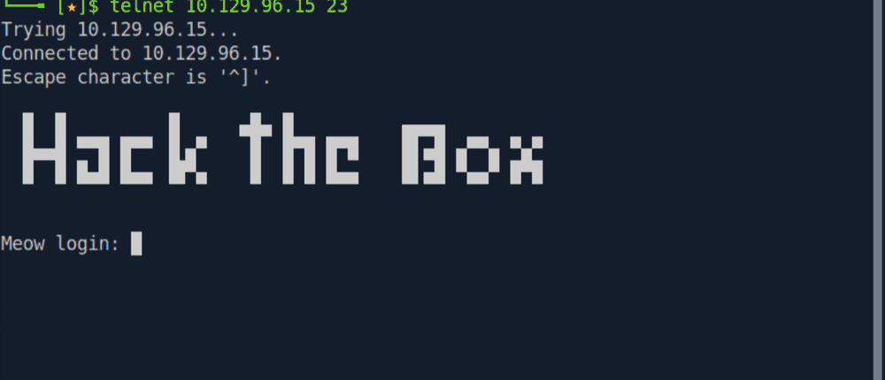

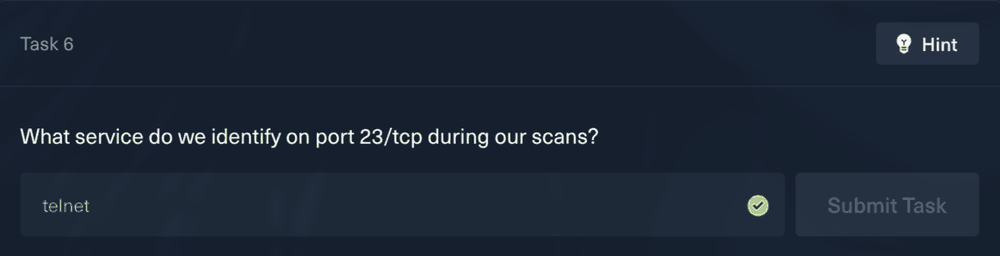

At the login prompt, try default usernames such as `admin`, `administrator`, and `root`. For this machine, the username is `root` and the password can be left blank.

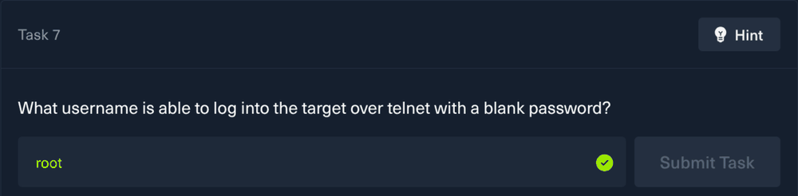

After logging in, you have a root shell on the target.

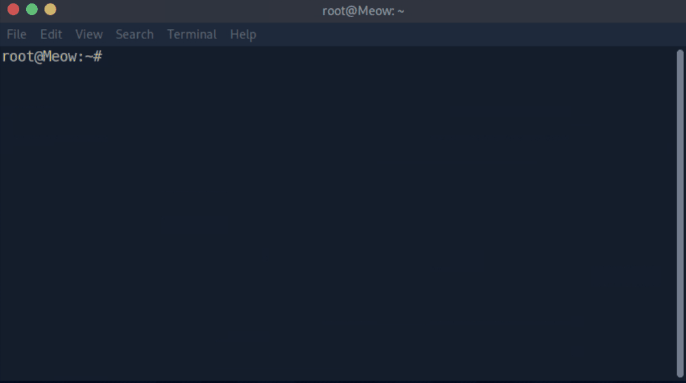

Use `ls` to list the files. The flag is in `flag.txt`; its value is redacted in accordance with the repository's spoiler policy.
